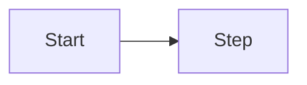

> **NOT PERFORMED in this run.** The request was a mobile-design audit plus a dark/light mode. This module was not run separately; see FULL-AUDIT.md section 1 (scope).

# Workflow map

One structured map (and a Mermaid flowchart where helpful) per workflow, from the real navigation and handlers.

